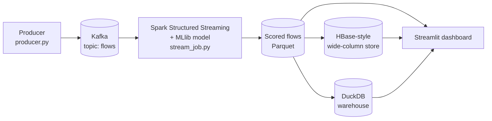

# Real-Time Network Performance & Congestion Predictor

A real-time big-data pipeline in Python. It streams network traffic through **Kafka**, uses **Spark Structured Streaming + MLlib** to score every flow with a machine-learning model that predicts degraded performance, stores the results in a **wide-column (HBase-style) store** and a **DuckDB warehouse**, and shows per-link health and alerts in a **Streamlit dashboard**.

Everything runs locally on **Windows** (no Docker, no WSL, no Linux).

---

## What it does

1. **Replays real network flow records** (UNSW-NB15) as if they were live traffic.
2. **Kafka** carries the events (topic `flows`).
3. **Spark Structured Streaming** groups traffic into 10-second windows per link and scores every flow with a trained Random Forest.
4. Each flow gets a **probability of being "degraded"** (heavy packet loss or high jitter). High-probability flows raise **alerts**.
5. Results are stored in an **HBase-style wide-column store** (fast lookups by row key) and a **DuckDB warehouse** (SQL analytics).
6. A **dashboard** shows live link health, alerts, model quality, and lets you browse the stored data.

### Why a model, if "degraded" is defined by a rule?
"Degraded" is defined by packet loss and jitter, which are only known after measuring a connection in detail. The model never sees those columns. It learns what a bad connection looks like from general behaviour (size, rate, duration, handshake timing, protocol), so it can **predict** trouble from the traffic pattern alone.

---

## Architecture



| Layer | Technology |
|---|---|
| Ingestion | Python producer, Apache Kafka 3.9 (KRaft mode, no Zookeeper) |
| Stream processing | Apache Spark 3.5 (PySpark) Structured Streaming |
| Machine learning | Spark MLlib Random Forest (trained offline, applied in the stream) |
| Wide-column store | HBase data model implemented on DuckDB (see Limitations) |
| Warehouse / analytics | DuckDB + SQL, matplotlib charts |
| Dashboard | Streamlit + Altair |

---

## Data

- **Dataset:** UNSW-NB15, Parquet version of the training set (175,341 flows) and testing set (82,332 flows), 36 columns each.
- The dataset is **not included** in this repository. Download the two Parquet files and place them in `data/`:
  - `data/UNSW_NB15_training-set.parquet`
  - `data/UNSW_NB15_testing-set.parquet`
- **"Degraded" label** (built in `prepare_data.py`): a flow is degraded if its packet-loss ratio is above the 85th percentile **or** its average jitter is above the 90th percentile of the training set. Thresholds come from the training set only and are saved to `data/thresholds.json`. Result: 21.3% degraded in train, 24.7% in test.
- **Links are simulated:** the dataset has no link or timestamp information, so the producer assigns each flow to one of 8 links (`link-1` to `link-8`) at random and stamps it with the send time.

---

## Model results

Random Forest (50 trees, max depth 8). Inputs are flow-behaviour columns plus one-hot encoded protocol, service, and state. The columns that define the label (loss and jitter) are **not** model inputs.

| Evaluation | AUC | Precision | Recall | Accuracy |
|---|---|---|---|---|
| Held-out test set (82,332 flows) | 0.994 | 95.2% | 92.6% | 97.0% |
| Streamed sample (2,000 flows, 205 alerts) | n/a | 95.1% | 93.3% | 97.1% |

Alerts are flows predicted degraded with probability >= 0.80.

### Charts (generated by `warehouse.py`)


---

## HBase-style storage design

| Item | Design |
|---|---|
| Row key | `link_id#reversed_timestamp#flow_id` (the timestamp is reversed so the newest flow of a link sorts first) |
| Tables | `flows`, `alerts` |
| Column families | `flow:` (traffic fields), `pred:` (model output), `alert:` (alert details) |
| Cell model | row key, family:qualifier, timestamp, value |
| Operations | `get` by row key, `scan` by row-key prefix, `scan` by row-key range |

The warehouse has a fact table `fact_flows` (one row per flow) and a view `v_alerts` (flows predicted degraded with probability >= 0.8).

---

## Project structure

```
.
├── prepare_data.py     # clean data, build the degraded label, save thresholds
├── train_model.py      # train + save the Spark MLlib Random Forest
├── producer.py         # replay test flows into Kafka (topic: flows)
├── stream_job.py       # Spark Structured Streaming: read Kafka, score, window metrics
├── hbase_layer.py      # load scored flows into the HBase-style store + demo scans
├── warehouse.py        # build DuckDB warehouse, run 6 SQL analyses, save charts/CSVs
├── dashboard.py        # Streamlit dashboard
├── show_outputs.py     # print where everything is stored; run your own SQL
├── dedupe_output.py    # optional: drop duplicate flows if events were sent twice
├── inspect_data.py     # print dataset columns and sample rows
├── test_spark.py       # Spark smoke test
├── models/             # trained model + metrics.json
├── output/charts/      # chart images
└── data/               # datasets and databases (git-ignored, rebuilt by the scripts)
```

---

## Setup (Windows 10/11)

### 1. Python 3.11
Install **Python 3.11** from python.org and tick "Add python.exe to PATH". Use 3.11: newer versions (3.12 and above) may lack prebuilt wheels for some packages and force a C++ build.

### 2. Java 17
Install **Eclipse Temurin JDK 17** (Windows `.msi`, from adoptium.net) with "Set JAVA_HOME" and "Add to PATH" enabled. Check with `java -version`.

### 3. Hadoop helper files for Spark on Windows
1. Create `C:\hadoop\bin`.
2. From the **cdarlint/winutils** GitHub repo, folder `hadoop-3.3.5\bin`, download `winutils.exe` and `hadoop.dll` into `C:\hadoop\bin`.
3. Set the environment variable `HADOOP_HOME` to `C:\hadoop` and add `C:\hadoop\bin` to your `Path`.
4. Restart VS Code / your terminals.

`train_model.py` and `stream_job.py` expect Hadoop in `C:\hadoop` (edit the `HADOOP_HOME_WIN` / `HADOOP_HOME_FWD` lines at the top if yours is elsewhere). If saving the model fails with `UnsatisfiedLinkError`, also copy `hadoop.dll` to `C:\Windows\System32`.

### 4. Apache Kafka 3.9 (no Docker)
1. Download the Kafka 3.9.x binary (Scala 2.13) from kafka.apache.org/downloads.
2. Extract it so that `D:\kafka\bin\windows\kafka-server-start.bat` exists. Keep the path short.
3. In `D:\kafka\config\kraft\server.properties`, set:
```
   log.dirs=D:/kafka/kafka-logs
```
4. In a standalone PowerShell window, **format the storage once** (never run this again, it wipes Kafka's data):
```powershell
   cd D:\kafka
   .\bin\windows\kafka-storage.bat random-uuid
   .\bin\windows\kafka-storage.bat format -t PASTE_ID_HERE -c .\config\kraft\server.properties
```
5. Start Kafka (see "Run the demo" below), then create the topic once:
```powershell
   cd D:\kafka
   .\bin\windows\kafka-topics.bat --create --topic flows --bootstrap-server localhost:9092
```

The message `'wmic' is not recognized` when Kafka starts is harmless.

### 5. Project environment
```powershell
git clone https://github.com/YOUR-USERNAME/YOUR-REPO.git
cd YOUR-REPO
python -m venv .venv
.venv\Scripts\Activate.ps1
python -m pip install --upgrade pip
pip install pyspark==3.5.3 kafka-python pandas scikit-learn pyarrow duckdb matplotlib streamlit
```
If PowerShell blocks activation, run `Set-ExecutionPolicy -Scope CurrentUser RemoteSigned` once.

Check Spark works: `python test_spark.py` should print a table with ids 0 to 4.

### 6. Dataset
Put the two UNSW-NB15 Parquet files in `data/` (see Data above).

---

## Run

### One-time: prepare data and train the model
```powershell
python prepare_data.py
python train_model.py
```
`prepare_data.py` creates the cleaned data and `data/thresholds.json`. `train_model.py` saves the model to `models/rf_congestion` and prints the test-set results (a few minutes).

### Run the demo
Four windows. Only Kafka runs in a standalone PowerShell; the other three are VS Code terminals with `(.venv)` active.

| # | Where | What | Command |
|---|---|---|---|
| 1 | Standalone PowerShell | Kafka server | `cd D:\kafka` then `$env:KAFKA_HEAP_OPTS="-Xmx1G -Xms1G"` then `.\bin\windows\kafka-server-start.bat .\config\kraft\server.properties` |
| 2 | VS Code terminal 1 | Stream job | `python stream_job.py --seconds 300` |
| 3 | VS Code terminal 2 | Dashboard | `streamlit run dashboard.py` |
| 4 | VS Code terminal 3 | Producer | `python producer.py --rate 100 --limit 2000` |

Order and timing:
1. Start Kafka and wait for `Kafka Server started`.
2. Start the stream job. Wait for `Streaming started...`, then about 15 more seconds. The first run downloads the Spark-Kafka connector from the internet. The job reads only events sent after it starts, and it clears `checkpoints/` and `output/scored_flows/` on every start.
3. Start the dashboard (opens at http://localhost:8501) on the **Live monitor** tab.
4. Start the producer **once** and watch the cards, charts, and alert feed update.
5. When the stream job stops, refresh the stored data:
```powershell
   python hbase_layer.py
   python warehouse.py
```
6. In the dashboard, press F5 and open **Analytics** and **Data explorer**.
7. Stop the dashboard and Kafka with `Ctrl+C` (answer `y` if asked `Terminate batch job (Y/N)?`).

If the same events were sent twice by mistake, run `python dedupe_output.py` before step 5.

### Look inside the stored data
```powershell
python show_outputs.py                                              # locations, tables, samples, model results
python show_outputs.py --sql "SHOW TABLES"
python show_outputs.py --sql "SELECT * FROM fact_flows LIMIT 5"
python show_outputs.py --db hbase --sql "SELECT * FROM flows LIMIT 10"
```

### Where everything is stored

| What | Location |
|---|---|
| Scored flows (stream output) | `output/scored_flows/` (Parquet) |
| HBase-style store | `data/hbase_lite.duckdb` |
| Warehouse | `data/warehouse.duckdb` |
| Charts / SQL reports | `output/charts/`, `output/reports/` |
| Trained model + metrics | `models/rf_congestion/`, `models/metrics.json` |
| Raw Kafka events | `D:\kafka\kafka-logs\` |

---

## Limitations (please read)

- **Links are simulated.** Flows are assigned to 8 links at random, so differences between links are noise by design. They demonstrate per-link monitoring and are not findings.
- **Only TCP shows packet loss** in this dataset, so UDP flows can never be labelled degraded.
- **The label is rule-based** (loss or jitter above a percentile). The model does not see those columns, but some inputs correlate with them, which is part of why the scores are so high. High AUC here does not mean the problem is easy in the real world.
- **The "HBase" layer is an emulation** of the HBase wide-column data model (row keys, column families, cells, get/scan) on top of DuckDB. Real HBase is not practical on native Windows. The design carries over to real HBase with small code changes.
- **The test split has more attack traffic** than the training split, so its degraded share is slightly higher (24.7% vs 21.3%).
- The dashboard displays times in `Asia/Kolkata` (change `TZ` at the top of `dashboard.py`).

---

## Troubleshooting

| Problem | Fix |
|---|---|
| `pip install` tries to compile and asks for "Microsoft C++ Build Tools" | Your venv uses a too-new Python. Recreate it with Python 3.11: `py -3.11 -m venv .venv` |
| Spark: `Invalid Spark URL ... Lalit_PC...` | The PC name contains underscores. The scripts set `spark.driver.host` to `127.0.0.1`, keep those two config lines in every Spark script |
| `UnsatisfiedLinkError ... NativeIO$Windows` | `hadoop.dll` is missing from `C:\hadoop\bin` (also copy it to `C:\Windows\System32`) |
| `Hadoop home directory C:hadoop is not an absolute path` | Use forward slashes (`C:/hadoop`) in Java options, as in the provided scripts |
| Repeated `Connection to node -1 ... could not be established` | Kafka is not running. Start it and wait for `Kafka Server started` |
| Lots of `SUCCESS: The process ... has been terminated` at the end of a Spark run | Normal Windows cleanup output, not an error |
| Red errors after pressing `Ctrl+C` on the stream job | Harmless (Spark was stopped mid-batch). Use `--seconds N` for a clean stop |
| Dashboard says "Waiting for data" | Check that `output/scored_flows/` has `.parquet` files and the stream job printed `[flows] batch ...` lines |

---
