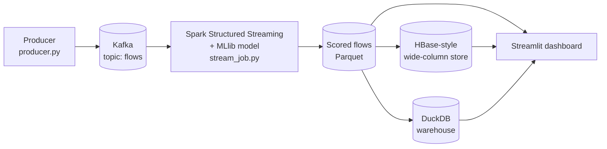

# Real-Time Network Performance & Congestion Predictor

A real-time big-data pipeline in Python. It streams network traffic through **Kafka**, uses **Spark Structured Streaming + MLlib** to score every flow with a machine-learning model that predicts degraded performance, stores the results in a **wide-column (HBase-style) store** and a **DuckDB warehouse**, and shows per-link health and alerts in a **Streamlit dashboard**.

Runs locally on **macOS, Linux, and Windows**.

---

## What it does

1. **Replays real network flow records** (UNSW-NB15) as if they were live traffic.
2. **Kafka** carries the events (topic `flows`).
3. **Spark Structured Streaming** groups traffic into 10-second windows per link and scores every flow with a trained Random Forest.
4. Each flow gets a **probability of being "degraded"** (heavy packet loss or high jitter). High-probability flows raise **alerts**.
5. Results are stored in an **HBase-style wide-column store** (fast lookups by row key) and a **DuckDB warehouse** (SQL analytics).
6. A **dashboard** shows live link health, alerts, model quality, and lets you browse the stored data.

### Why a model, if "degraded" is defined by a rule?
"Degraded" is defined by packet loss and jitter, which are only known after measuring a connection in detail. The model never sees those columns. It learns what a bad connection looks like from general behaviour (size, rate, duration, handshake timing, protocol), so it can **predict** trouble from the traffic pattern alone.

---

## Architecture



| Layer | Technology |
|---|---|
| Ingestion | Python producer, Apache Kafka 3.9 (KRaft mode, no Zookeeper) |
| Stream processing | Apache Spark 3.5 (PySpark) Structured Streaming |
| Machine learning | Spark MLlib Random Forest (trained offline, applied in the stream) |
| Wide-column store | HBase data model implemented on DuckDB (see Limitations) |
| Warehouse / analytics | DuckDB + SQL, matplotlib charts |
| Dashboard | Streamlit + Altair |

---

## Data

- **Dataset:** UNSW-NB15, Parquet version of the training set (175,341 flows) and testing set (82,332 flows), 36 columns each.
- The dataset is **not included** in this repository. Download the two Parquet files and place them in `data/`:
  - `data/UNSW_NB15_training-set.parquet`
  - `data/UNSW_NB15_testing-set.parquet`
- **"Degraded" label** (built in `prepare_data.py`): a flow is degraded if its packet-loss ratio is above the 85th percentile **or** its average jitter is above the 90th percentile of the training set. Thresholds come from the training set only and are saved to `data/thresholds.json`. Result: 21.3% degraded in train, 24.7% in test.
- **Links are simulated:** the dataset has no link or timestamp information, so the producer assigns each flow to one of 8 links (`link-1` to `link-8`) at random and stamps it with the send time.

---

## Model results

Random Forest (50 trees, max depth 8). Inputs are flow-behaviour columns plus one-hot encoded protocol, service, and state. The columns that define the label (loss and jitter) are **not** model inputs.

| Evaluation | AUC | Precision | Recall | Accuracy |
|---|---|---|---|---|
| Held-out test set (82,332 flows) | 0.994 | 95.2% | 92.6% | 97.0% |
| Streamed sample (2,000 flows, 205 alerts) | n/a | 95.1% | 93.3% | 97.1% |

Alerts are flows predicted degraded with probability >= 0.80.

### Charts (generated by `warehouse.py`)


---

## HBase-style storage design

| Item | Design |
|---|---|
| Row key | `link_id#reversed_timestamp#flow_id` (the timestamp is reversed so the newest flow of a link sorts first) |
| Tables | `flows`, `alerts` |
| Column families | `flow:` (traffic fields), `pred:` (model output), `alert:` (alert details) |
| Cell model | row key, family:qualifier, timestamp, value |
| Operations | `get` by row key, `scan` by row-key prefix, `scan` by row-key range |

The warehouse has a fact table `fact_flows` (one row per flow) and a view `v_alerts` (flows predicted degraded with probability >= 0.8).

---

## Project structure

```
.
├── config.py           # centralized cross-platform paths, constants, Spark session builder
├── requirements.txt    # pinned dependencies
├── prepare_data.py     # clean data, build the degraded label, save thresholds
├── train_model.py      # train + save the Spark MLlib Random Forest
├── producer.py         # replay test flows into Kafka (topic: flows)
├── stream_job.py       # Spark Structured Streaming: read Kafka, score, window metrics
├── hbase_layer.py      # load scored flows into the HBase-style store + demo scans
├── warehouse.py        # build DuckDB warehouse, run 6 SQL analyses, save charts/CSVs
├── dashboard.py        # Streamlit dashboard
├── show_outputs.py     # print where everything is stored; run your own SQL
├── dedupe_output.py    # optional: drop duplicate flows if events were sent twice
├── inspect_data.py     # print dataset columns and sample rows
├── test_spark.py       # Spark smoke test
├── models/             # trained model + metrics.json
├── output/charts/      # chart images
└── data/               # datasets and databases (git-ignored, rebuilt by the scripts)
```

---

## Setup

### 1. Python (3.10 – 3.12 recommended, e.g. 3.11)
- **macOS (Homebrew):** `brew install python@3.11`
- **Linux (Ubuntu/Debian):** `sudo apt update && sudo apt install -y python3.11 python3.11-venv python3-pip`
- **Windows:** Download Python 3.11 from python.org and check "Add python.exe to PATH".

### 2. Java 17
- **macOS (Homebrew):** `brew install openjdk@17`
- **Linux (Ubuntu/Debian):** `sudo apt install -y openjdk-17-jdk`
- **Windows:** Install **Eclipse Temurin JDK 17** from adoptium.net with "Set JAVA_HOME" and "Add to PATH" enabled. Check with `java -version`.

### 3. Hadoop helper files for Spark (Windows ONLY)
*On macOS and Linux, skip this step completely — Hadoop native binaries are not required.*

On Windows only:
1. Create `C:\hadoop\bin`.
2. From the **cdarlint/winutils** GitHub repo (folder `hadoop-3.3.5\bin`), download `winutils.exe` and `hadoop.dll` into `C:\hadoop\bin`.
3. Set the environment variable `HADOOP_HOME` to `C:\hadoop` and add `C:\hadoop\bin` to your `Path`.

### 4. Apache Kafka 3.9 (KRaft mode, no Zookeeper)

#### macOS (via Homebrew)
```bash
brew install kafka
# Start Kafka service:
brew services start kafka
# Or start in foreground with default KRaft config:
kafka-server-start /opt/homebrew/etc/kafka/kraft/server.properties
```

#### Linux / Manual Archive (macOS / Linux)
1. Download the Kafka 3.9.x binary (Scala 2.13) from kafka.apache.org/downloads and extract it (e.g. to `~/kafka`).
2. Format storage (run once):
   ```bash
   cd ~/kafka
   KAFKA_CLUSTER_ID="$(bin/kafka-storage.sh random-uuid)"
   bin/kafka-storage.sh format -t $KAFKA_CLUSTER_ID -c config/kraft/server.properties
   ```
3. Start Kafka:
   ```bash
   bin/kafka-server-start.sh config/kraft/server.properties
   ```
4. Create the topic:
   ```bash
   bin/kafka-topics.sh --create --topic flows --bootstrap-server localhost:9092
   ```

#### Windows
1. Download Kafka 3.9.x binary and extract to `D:\kafka` (or `C:\kafka`).
2. In `config\kraft\server.properties`, set `log.dirs=D:/kafka/kafka-logs`.
3. In PowerShell, format storage (run once):
   ```powershell
   cd D:\kafka
   $id = .\bin\windows\kafka-storage.bat random-uuid
   .\bin\windows\kafka-storage.bat format -t $id -c .\config\kraft\server.properties
   ```
4. Start Kafka:
   ```powershell
   .\bin\windows\kafka-server-start.bat .\config\kraft\server.properties
   ```
5. Create the topic:
   ```powershell
   .\bin\windows\kafka-topics.bat --create --topic flows --bootstrap-server localhost:9092
   ```

### 5. Project Environment

#### macOS / Linux
```bash
git clone https://github.com/YOUR-USERNAME/YOUR-REPO.git
cd YOUR-REPO
python3 -m venv .venv
source .venv/bin/activate
pip install --upgrade pip
pip install -r requirements.txt
```

#### Windows (PowerShell)
```powershell
git clone https://github.com/YOUR-USERNAME/YOUR-REPO.git
cd YOUR-REPO
python -m venv .venv
.venv\Scripts\Activate.ps1
python -m pip install --upgrade pip
pip install -r requirements.txt
```

Verify Spark works:
```bash
python test_spark.py
```
This should print a Spark table with IDs 0 to 4.

### 6. Dataset
Download the UNSW-NB15 Parquet files into `data/`:
- `data/UNSW_NB15_training-set.parquet`
- `data/UNSW_NB15_testing-set.parquet`

---

## Run

### 1. Prepare data and train the model (One-time)
```bash
python prepare_data.py
python train_model.py
```
`prepare_data.py` creates the cleaned data and `data/thresholds.json`. `train_model.py` saves the model to `models/rf_congestion` and logs test metrics to `models/metrics.json`.

### 2. Run the real-time demo
Run each component in a separate terminal with `(.venv)` activated:

| # | Component | Terminal Command |
|---|---|---|
| 1 | **Kafka server** | macOS/Linux: `kafka-server-start ...` or Windows: `.\bin\windows\kafka-server-start.bat ...` |
| 2 | **Stream job** | `python stream_job.py --seconds 300` |
| 3 | **Dashboard** | `streamlit run dashboard.py` |
| 4 | **Producer** | `python producer.py --rate 100 --limit 2000` |

Order of execution:
1. Start Kafka and verify it is listening on `localhost:9092`.
2. Start the stream job (`python stream_job.py`). Wait until `Streaming started...` appears. (The first run downloads the Spark-Kafka connector jar).
3. Start the dashboard (`streamlit run dashboard.py`), open http://localhost:8501, and navigate to **Live monitor**.
4. Start the producer (`python producer.py --rate 100 --limit 2000`) and watch live cards, charts, and alert feeds update.
5. After the stream completes, refresh the offline analytical stores:
   ```bash
   python hbase_layer.py
   python warehouse.py
   ```
6. In the dashboard, view the **Analytics** and **Data explorer** tabs.

### 3. Inspect stored data & run SQL
```bash
python show_outputs.py                                              # Inspect locations, schemas, and metrics
python show_outputs.py --sql "SHOW TABLES"
python show_outputs.py --sql "SELECT * FROM fact_flows LIMIT 5"
python show_outputs.py --db hbase --sql "SELECT * FROM flows LIMIT 10"
```

### Storage Locations

| Artifact | Location |
|---|---|
| Scored flows (streaming output) | `output/scored_flows/` (Parquet) |
| HBase-style store | `data/hbase_lite.duckdb` |
| DuckDB Warehouse | `data/warehouse.duckdb` |
| Generated charts & reports | `output/charts/`, `output/reports/` |
| Trained ML model + metrics | `models/rf_congestion/`, `models/metrics.json` |
| Raw Kafka events | Configured via `KAFKA_LOGS_DIR` (or platform default) |

---

## Limitations

- **Links are simulated:** Flows are assigned to 8 links at random, so variations between links are noise by design to demonstrate per-link telemetry.
- **Only TCP shows packet loss:** In the UNSW-NB15 dataset, loss statistics are recorded for TCP flows; UDP flows are labeled based on jitter.
- **Rule-based labeling:** Ground truth is derived from quantile thresholds on loss and jitter. Model inputs omit loss and jitter to avoid direct target leakage.
- **HBase emulation:** The wide-column store emulates HBase primitives (row-keys, column families, cells, scans) using DuckDB for local execution without requiring a heavy distributed cluster.

---

## Troubleshooting

| Problem | Root Cause & Resolution |
|---|---|
| `pip install` errors asking for C++ build tools | Use Python 3.10–3.12 (e.g. 3.11) where prebuilt binary wheels are readily available for all dependencies. |
| Spark: `Invalid Spark URL ...` | Occurs when hostnames contain special characters or underscores. Both `stream_job.py` and `train_model.py` automatically bind `spark.driver.host` to `127.0.0.1`. |
| Windows: `UnsatisfiedLinkError ... NativeIO$Windows` | Missing `hadoop.dll`. Place `hadoop.dll` in `C:\hadoop\bin` and verify `HADOOP_HOME` is set. |
| macOS/Linux: `Connection refused: localhost:9092` | Kafka is not running. Ensure Kafka service is started before launching the stream job or producer. |
| Dashboard shows "Waiting for data" | Verify that `stream_job.py` is actively writing to `output/scored_flows/` and the producer is running. |
