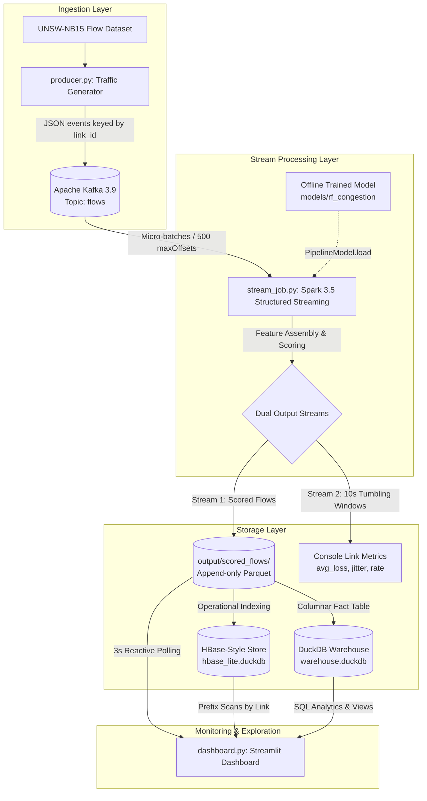
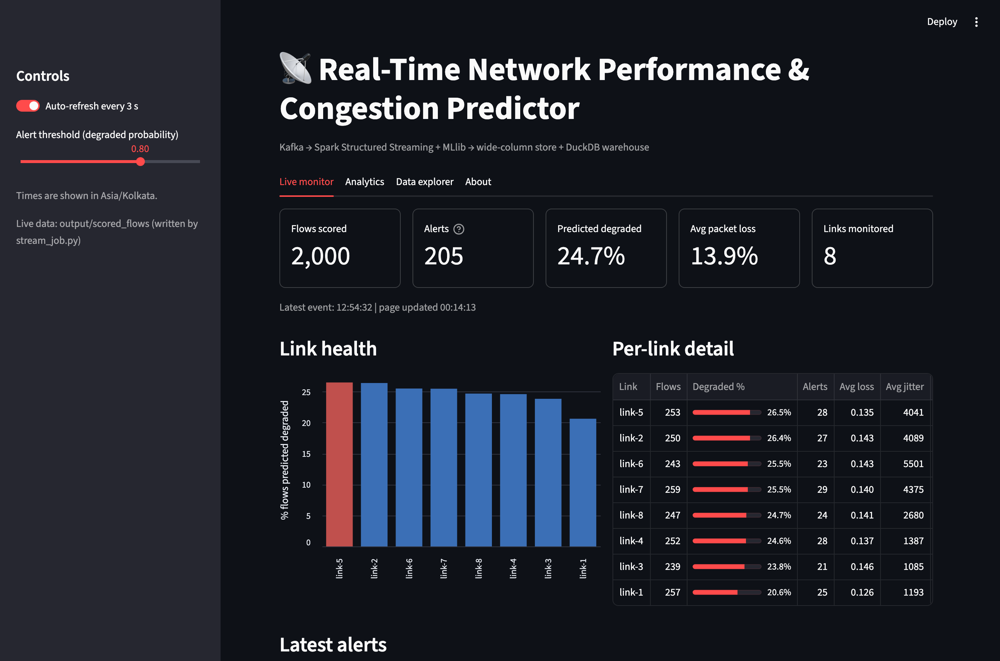
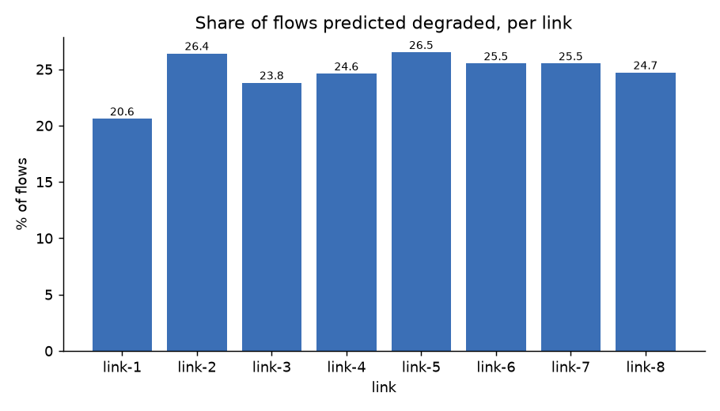
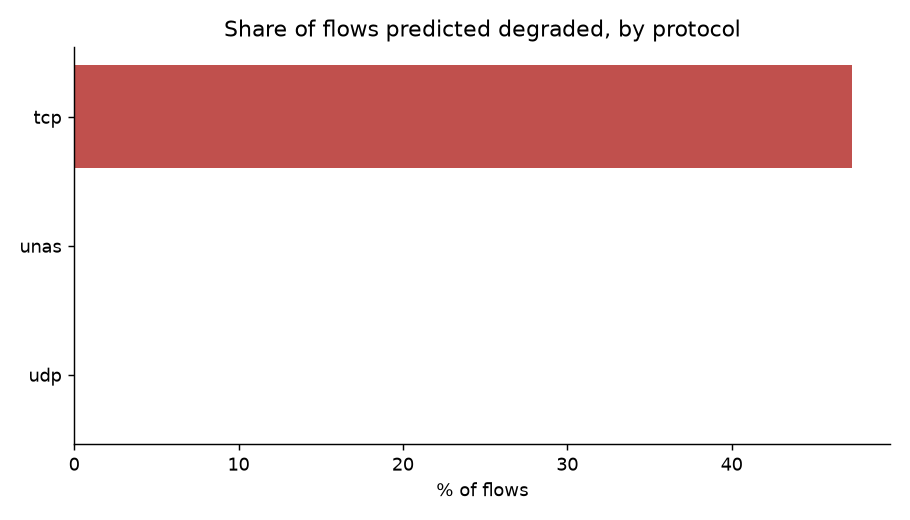
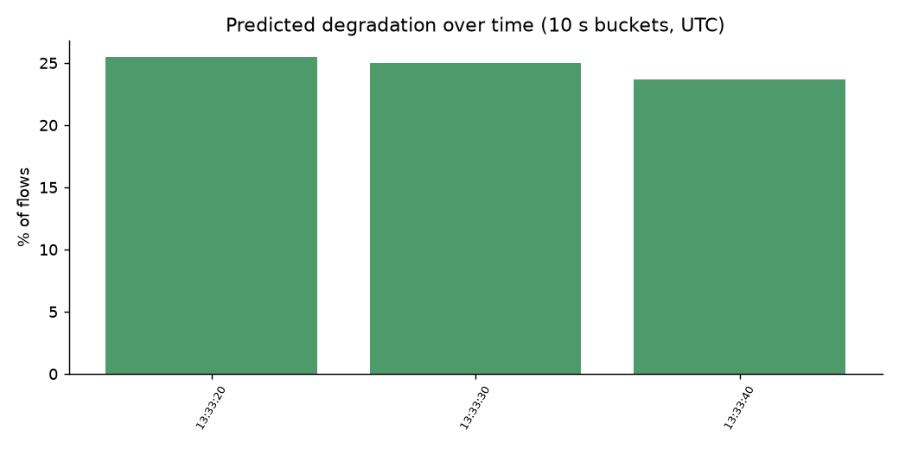

# 📡 NetPref: Real-Time Network Performance & Congestion Predictor

[](https://python.org)
[](https://spark.apache.org/)
[-black?logo=apachekafka&logoColor=white)](https://kafka.apache.org/)
[](https://duckdb.org/)
[](https://streamlit.io/)
[](#setup)
[](NetPref_Project_Guide.pdf)

A distributed, real-time big data telemetric and predictive intelligence pipeline. It streams live network traffic through **Apache Kafka**, scores every flow in real time using **Apache Spark Structured Streaming + MLlib Random Forest** to predict impending network degradation (packet loss and high jitter) *before* directly measuring them, stores results in an **HBase-style wide-column store** and a **DuckDB analytical warehouse**, and visualizes live per-link health and alerts in a **Streamlit NOC dashboard**.

Runs seamlessly and natively on **macOS (Apple Silicon & Intel), Linux (Ubuntu/Debian), and Windows**.

---

## 📑 Table of Contents
- [Why NetPref?](#-why-netpref)
- [System Architecture](#-system-architecture)
- [Technology Stack](#-technology-stack)
- [The Machine Learning Engine](#-the-machine-learning-engine)
- [Storage Architecture (HBase-Style & DuckDB Warehouse)](#-storage-architecture)
- [Interactive Dashboard Showcase](#-interactive-dashboard-showcase)
- [Project Directory Layout](#-project-directory-layout)
- [Setup & Prerequisites](#-setup--prerequisites)
- [Step-by-Step Run & Demo Guide](#-step-by-step-run--demo-guide)
- [Analytical Reports & SQL Exploration](#-analytical-reports--sql-exploration)
- [Real-World Applications](#-real-world-applications)
- [Limitations & Troubleshooting](#-limitations--troubleshooting)
- [Documentation & Future Roadmap](#-documentation--future-roadmap)

---

## 💡 Why NetPref?

In modern high-speed networks, network congestion degrades user experience through **packet loss** (dropped packets due to buffer overflow) and **high jitter** (erratic variance in packet arrival times).

```
Traditional Reactive Monitoring                      NetPref Real-Time Predictive Intelligence
───────────────────────────────                      ─────────────────────────────────────────
1. Packets dropped in router buffers                 1. Inspects ongoing flow behavioral patterns
2. Connection experiences latency collapse              (duration, rates, packet sizes, TCP RTT)
3. User experiences frozen video / buffering         2. ML Random Forest scores degradation probability
4. Tool logs packet loss AFTER connection finishes   3. Alerts operator BEFORE buffer collapse occurs
```

> **The Highway Analogy:** Traditional network monitoring counts how many cars crashed or came to a dead stop 10 minutes ago. **NetPref** watches vehicle speed variance, sudden braking, and erratic lane changes to predict traffic collapse *before* the highway reaches total gridlock.

### The Core Research Principle: Zero Target Leakage
Packet loss and jitter are the ground-truth definitions of a degraded connection. However, **these metrics are strictly omitted from the model's feature set during training**. The model learns purely from general behavioral attributes (connection duration, transfer rates, mean packet sizes, and TCP handshake round-trip timings) so it can predict degradation on live traffic without needing to wait for or measure packet drops.

---

## 🏛️ System Architecture



---

## 🛠️ Technology Stack

| Layer | Technology | Architectural Role |
| :--- | :--- | :--- |
| **Ingestion** | **Python 3 Producer + Kafka 3.9 (KRaft)** | Replays real flow records into Kafka topic `flows`, partitioned by `link_id`. Uses KRaft consensus (no ZooKeeper needed). |
| **Stream Compute** | **Apache Spark 3.5 (PySpark Streaming)** | Micro-batch stream processing (5s trigger), JSON deserialization, schema enforcement, watermarking (30s), and tumbling 10s window aggregation. |
| **Machine Learning** | **Spark MLlib Random Forest** | 50 decision trees, max depth 8. Evaluated natively in Spark's distributed runtime for high-throughput parallel scoring. |
| **Operational Store** | **HBaseLite (DuckDB Key-Value)** | Emulates HBase wide-column primitives with compound row keys (`link_id#reversed_ts#flow_id`) and column families (`flow:`, `pred:`, `alert:`). |
| **Analytical Store** | **DuckDB Columnar Warehouse** | Hosts `fact_flows` table and `v_alerts` view for sub-second SQL analytics, protocol breakdown, and longitudinal metrics. |
| **Visualization** | **Streamlit + Altair** | Reactive dark-mode NOC dashboard with real-time metric cards, link health bars, live alert feeds, and an interactive SQL console. |

---

## 🧠 The Machine Learning Engine

The model is trained in [train_model.py](file:///Users/praneeth/Sandbox/NetPref/train_model.py) using an offline MLlib Pipeline:
1. **StringIndexer & OneHotEncoder:** Encodes categorical network parameters (`proto`, `service`, `state`).
2. **VectorAssembler:** Assembles 19 numerical flow features + one-hot encoded vectors into a single feature vector.
3. **RandomForestClassifier:** 50 trees, max depth 8, seed 42.

### Evaluated Model Performance

| Metric | Held-Out Test Set (82,332 flows) | Live Streamed Sample (2,000 flows) |
| :--- | :---: | :---: |
| **ROC AUC** | **0.9945** | **0.994** |
| **PR AUC** | **0.9848** | — |
| **Overall Accuracy** | **97.00%** | **97.10%** |
| **Precision (Degraded)** | **95.16%** | **95.10%** |
| **Recall (Degraded)** | **92.57%** | **93.30%** |
| **F1 Score (Degraded)** | **0.9385** | **0.9419** |

### Top Predictive Features
Feature importances extracted from the trained model:
1. `dur` (Connection duration in seconds) &mdash; **13.20%**
2. `dpkts` (Packets from destination to source) &mdash; **7.78%**
3. `swin` (Source TCP window advertisement size) &mdash; **6.62%**
4. `proto_ohe_tcp` (TCP transport protocol flag) &mdash; **6.08%**
5. `spkts` (Packets from source to destination) &mdash; **5.87%**
6. `dinpkt` (Destination inter-packet arrival time in ms) &mdash; **5.85%**
7. `dmean` (Mean packet size transmitted by destination) &mdash; **5.53%**
8. `dbytes` (Total bytes transmitted by destination) &mdash; **5.48%**
9. `tcprtt` (Round-trip time: SYN to ACK) &mdash; **4.75%**
10. `ackdat` (SYN-ACK to ACK latency) &mdash; **4.11%**

---

## 🗄️ Storage Architecture

### 1. HBase-Style Wide-Column Store (`hbase_lite.duckdb`)
To emulate an Apache HBase / Google Cloud Bigtable operational store without requiring a multi-node Hadoop cluster, [hbase_layer.py](file:///Users/praneeth/Sandbox/NetPref/hbase_layer.py) implements the cell data model:
- **Compound Row Key:**
  $$\text{Row Key} = \texttt{link\_id} \mathbin{\#} (9999999999999 - \text{timestamp\_ms}) \mathbin{\#} \texttt{flow\_id}$$
  *Why reversed timestamps?* Lexicographical sorting orders smaller strings first. Subtracting the timestamp from a large constant guarantees that the **newest flow on any link always sorts to the top**, enabling sub-millisecond prefix scans for latest link activity.
- **Column Families:**
  - `flow:` &mdash; Network fields (`proto`, `service`, `state`, `total_pkts`, `total_bytes`, `loss_ratio`, `avg_jitter`)
  - `pred:` &mdash; Inference output (`degraded_prob`, `prediction`, `true_degraded`)
  - `alert:` &mdash; High-probability alert records ($P(\text{degraded}) \ge 0.80$)

### 2. DuckDB Analytical Warehouse (`warehouse.duckdb`)
- **`fact_flows`:** One row per scored flow with native timestamps, link identifiers, network metrics, and prediction probabilities.
- **`v_alerts`:** An instant SQL view filtering high-risk flows where `prediction = 1 AND degraded_prob >= 0.80`.

---

## 🖥️ Interactive Dashboard Showcase

The Streamlit dashboard ([dashboard.py](file:///Users/praneeth/Sandbox/NetPref/dashboard.py)) updates every 3 seconds to provide real-time NOC situational awareness:



- **Live Metric Cards:** Total flows scored, active alerts ($P \ge 0.80$), % flows predicted degraded, average packet loss, and count of monitored links.
- **Per-Link Health Bar Chart:** Color-coded bars showing degradation percentage per link, with the worst-performing link automatically highlighted in **red**.
- **Per-Link Detail Table:** Tabular progress indicators for degradation rate, raw alert counts, average loss ratio, mean jitter, and throughput in MB.
- **Real-Time Alert Feed:** Reverse-chronological table of the latest 12 high-priority alerts with protocol, service, loss %, and probability progress bars.
- **Temporal Degradation Line Chart:** 10-second tumbling time buckets displaying degradation rates against flow volumes over time.
- **Interactive SQL Console & Data Explorer:** In-browser query editor allowing operators to run custom read-only DuckDB SQL queries against both the warehouse and the HBase-style store.

---

## 📂 Project Directory Layout

```
NetPref/
├── config.py                 # Centralized cross-platform paths, constants, Spark session builder
├── prepare_data.py           # Ingests UNSW-NB15, sets loss/jitter thresholds, builds labels
├── train_model.py            # Trains Spark MLlib Random Forest, saves model & metrics.json
├── producer.py               # Replays test flows into Kafka topic 'flows' at configurable rates
├── stream_job.py             # Spark Structured Streaming: Kafka consumer, MLlib scoring, windows
├── hbase_layer.py            # HBase wide-column store emulation, puts cells, runs prefix scans
├── warehouse.py              # Builds DuckDB warehouse, executes 6 SQL analyses, generates charts
├── dashboard.py              # Streamlit NOC dashboard (Live monitor, Analytics, Data explorer)
├── show_outputs.py           # Diagnostic CLI: storage locations, table inspection, SQL console
├── dedupe_output.py          # Utility: drops duplicate flow IDs from streaming parquet output
├── test_cross_platform.py    # Unit tests verifying cross-platform paths, Kafka config, and row keys
├── test_spark.py             # Smoke test verifying PySpark and Java 17 runtime
├── requirements.txt          # Pinned Python package dependencies
├── ROADMAP.md                # Phase-by-phase architectural & engineering improvement roadmap
├── NetPref_Project_Guide.pdf # 5-page publication-quality system guide & demo manual
├── models/
│   ├── rf_congestion/        # Serialized Spark MLlib Random Forest PipelineModel
│   └── metrics.json          # Test-set evaluation metrics and top feature importances
├── output/
│   ├── charts/               # Generated analytical PNG charts
│   ├── reports/              # Exported analytical CSV reports
│   ├── screenshots/          # High-resolution dashboard screenshots
│   └── scored_flows/         # Append-only micro-batch Parquet files written by Spark
└── data/                     # (Git-ignored) Datasets, thresholds.json, and DuckDB databases
```

---

## ⚙️ Setup & Prerequisites

### 1. Python Environment (3.10 – 3.12 recommended, e.g. 3.11)
```bash
# Clone the repository
git clone https://github.com/YOUR-USERNAME/NetPref.git
cd NetPref

# Create and activate virtual environment
python3 -m venv .venv

# macOS / Linux
source .venv/bin/activate

# Windows (PowerShell)
# .venv\Scripts\Activate.ps1

# Upgrade pip and install dependencies
pip install --upgrade pip
pip install -r requirements.txt
```

### 2. Java 17 (Required by PySpark)
- **macOS (Homebrew):** `brew install openjdk@17` *(config.py automatically discovers Homebrew OpenJDK 17)*
- **Linux (Ubuntu/Debian):** `sudo apt update && sudo apt install -y openjdk-17-jdk`
- **Windows:** Download & install **Eclipse Temurin JDK 17** from [adoptium.net](https://adoptium.net) with "Set JAVA_HOME" and "Add to PATH" checked.

*Verify Spark works:*
```bash
python test_spark.py
```

### 3. Windows-Specific Hadoop Helper Files
*(macOS and Linux users skip this entirely)*  
1. Download `winutils.exe` and `hadoop.dll` from the `hadoop-3.3.5/bin` folder of the **cdarlint/winutils** GitHub repository.  
2. Place both files in `C:\hadoop\bin`.  
3. Set environment variable `HADOOP_HOME=C:\hadoop` and add `C:\hadoop\bin` to your `Path`.

### 4. Apache Kafka 3.9 (KRaft Mode, No ZooKeeper)
- **macOS (Homebrew):**
  ```bash
  brew install kafka
  brew services start kafka
  ```
- **Linux / Manual Archive:**
  ```bash
  # Format storage once
  KAFKA_CLUSTER_ID="$(bin/kafka-storage.sh random-uuid)"
  bin/kafka-storage.sh format -t $KAFKA_CLUSTER_ID -c config/kraft/server.properties
  
  # Start Kafka broker
  bin/kafka-server-start.sh config/kraft/server.properties
  ```
- **Windows:**
  ```powershell
  $id = .\bin\windows\kafka-storage.bat random-uuid
  .\bin\windows\kafka-storage.bat format -t $id -c .\config\kraft\server.properties
  .\bin\windows\kafka-server-start.bat .\config\kraft\server.properties
  ```

### 5. Dataset Placement
Download the UNSW-NB15 Parquet files into `data/`:
- `data/UNSW_NB15_training-set.parquet`
- `data/UNSW_NB15_testing-set.parquet`

---

## 🚀 Step-by-Step Run & Demo Guide

### Step 1: One-Time Data Prep and Model Training
Run these once to clean data, compute label quantiles, and train the Random Forest:
```bash
python prepare_data.py
python train_model.py
```

### Step 2: Live Real-Time Demonstration Sequence
Open **4 separate terminal windows** with `(.venv)` activated and execute in order:

| Terminal | Process | Exact Command | What to Look For |
| :---: | :--- | :--- | :--- |
| **1** | **Kafka Broker** | `kafka-server-start /opt/homebrew/etc/kafka/kraft/server.properties` | Broker listens on `localhost:9092`. |
| **2** | **Spark Stream Job** | `python stream_job.py --seconds 300` | Prints `Streaming started... Waiting for Kafka events`. |
| **3** | **Streamlit Dashboard** | `streamlit run dashboard.py` | Browser opens at `http://localhost:8501` on **Live monitor**. |
| **4** | **Kafka Producer** | `python producer.py --rate 100 --limit 2000` | Sends 2,000 events at 100/sec. Micro-batch batches score immediately! |

### Step 3: Populate Offline Analytical Stores
Once streaming completes, update the analytical databases and charts:
```bash
python hbase_layer.py        # Populates HBaseLite cells and executes demo prefix scans
python warehouse.py          # Refreshes DuckDB warehouse fact_flows, views, and PNG charts
python show_outputs.py       # Displays file sizes, record counts, and database schemas
```

---

## 📊 Analytical Reports & SQL Exploration

Running [warehouse.py](file:///Users/praneeth/Sandbox/NetPref/warehouse.py) automatically runs 6 SQL queries and saves both CSV reports ([output/reports/](file:///Users/praneeth/Sandbox/NetPref/output/reports)) and PNG charts ([output/charts/](file:///Users/praneeth/Sandbox/NetPref/output/charts)):

| Degradation Share by Link | Degradation by Protocol | Degradation Over Time (10s Buckets) |
| :---: | :---: | :---: |
|  |  |  |

### Interactive SQL Queries via CLI
Inspect stored data directly from the terminal with [show_outputs.py](file:///Users/praneeth/Sandbox/NetPref/show_outputs.py):
```bash
# Query the DuckDB Warehouse
python show_outputs.py --sql "SELECT link_id, COUNT(*) AS flows, ROUND(100.0 * AVG(prediction), 1) AS degraded_pct FROM fact_flows GROUP BY link_id ORDER BY degraded_pct DESC"

# Query the HBase-Style Store
python show_outputs.py --db hbase --sql "SELECT row_key, family, qualifier, value FROM flows WHERE starts_with(row_key, 'link-2#') LIMIT 10"
```

---

## 🌐 Real-World Applications

- **Internet Service Providers (ISPs) & Telecoms:** Real-time telemetric feedback for Software-Defined Network (SDN) controllers. If degradation probability rises on a trunk link, non-critical bulk traffic can be dynamically rerouted before queues drop packets.
- **Cloud Infrastructure & Data Centers (AWS / Azure / GCP):** Detects "noisy neighbor" virtual machines that saturate physical host network interfaces, isolating affected tenant flows without inspecting encrypted packet payloads.
- **Video Streaming & WebRTC (Zoom, Teams, Netflix):** Video codecs dynamically adjust bitrates based on packet loss feedback. NetPref provides proactive pre-congestion warnings seconds ahead of time, preventing video freezing.
- **AIOps & Self-Healing Networks:** Forms the telemetric foundation for autonomous network remediation, automatically triggering QoS bandwidth shaping and rate-limiting rules.

---

## ⚠️ Limitations & Troubleshooting

### Known Limitations
- **Simulated Link Topologies:** The benchmark dataset has no native link identifiers. The producer assigns flows randomly across 8 links to demonstrate per-link telemetric aggregation.
- **TCP vs. UDP Metrics:** UNSW-NB15 records packet loss counters for TCP connections only; UDP flows are classified primarily based on jitter metrics.
- **HBase Emulation:** The wide-column store emulates HBase primitives over DuckDB to enable seamless local execution without requiring a distributed multi-node Hadoop cluster.

### Common Troubleshooting

| Symptom | Root Cause | Solution |
| :--- | :--- | :--- |
| `Connection refused: localhost:9092` | Kafka broker is not running. | Start Kafka broker (Terminal 1) before starting the stream job or producer. |
| `Invalid Spark URL ...` | Hostname contains underscores or special characters. | `config.py` explicitly binds `spark.driver.host` to `127.0.0.1`. |
| Windows: `UnsatisfiedLinkError (hadoop.dll)` | Missing native Hadoop binaries on Windows. | Download `hadoop.dll` & `winutils.exe` into `C:\hadoop\bin` and verify `HADOOP_HOME`. |
| Dashboard shows "Waiting for data..." | Stream job has not output Parquet yet. | Verify `stream_job.py` is running and `producer.py` is actively sending events. |
| Streamlit duplicate key or caching error | Stale Parquet cache. | Toggle the auto-refresh switch or re-run `python dedupe_output.py`. |

---

## 📚 Documentation & Future Roadmap

- 📖 **Comprehensive System Guide & Demonstration PDF:**  
  Read the complete 5-page guide with detailed CS concepts, tech justifications, and the 5-minute pitch script:  
  👉 **[NetPref_Project_Guide.pdf](NetPref_Project_Guide.pdf)**
- 🗺️ **Engineering & Architectural Improvement Roadmap:**  
  Explore planned milestones for topology-aware simulation, continuous Kappa streaming, explainable AI (SHAP), and Docker orchestration:  
  👉 **[ROADMAP.md](ROADMAP.md)**

---

## 📜 License & Acknowledgments
- **Dataset:** UNSW-NB15 dataset provided by the Australian Centre for Cyber Security (ACCS).
- **License:** Open-source for academic, educational, and research use.
