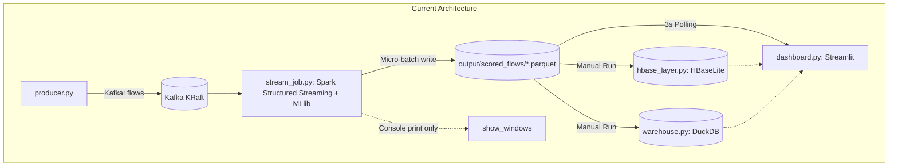
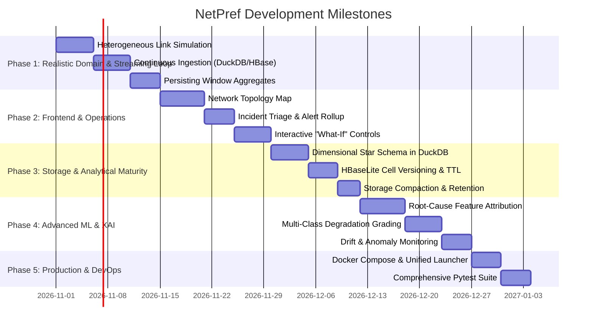

# NetPref: Engineering & Architectural Improvement Roadmap

A comprehensive, phase-by-phase implementation roadmap for evolving the **Real-Time Network Performance & Congestion Predictor (NetPref)** from a proof-of-concept into a production-grade, domain-realistic network intelligence platform.

---

## 1. Executive Summary & Architectural Baseline

### Current State
NetPref currently operates as a pipeline comprising:
- **Traffic Replay:** [producer.py](file:///Users/praneeth/Sandbox/NetPref/producer.py) replays the UNSW-NB15 dataset at a fixed rate, assigning events uniformly at random across 8 simulated links.
- **Stream Ingestion & Scoring:** [stream_job.py](file:///Users/praneeth/Sandbox/NetPref/stream_job.py) consumes from Kafka (`flows` topic), loads an offline-trained Spark MLlib Random Forest model ([models/rf_congestion/](file:///Users/praneeth/Sandbox/NetPref/models/rf_congestion)), scores flows, and writes micro-batches to Parquet files (`output/scored_flows/`).
- **Offline Analytical Sinks:** [hbase_layer.py](file:///Users/praneeth/Sandbox/NetPref/hbase_layer.py) (HBase wide-column emulation over DuckDB) and [warehouse.py](file:///Users/praneeth/Sandbox/NetPref/warehouse.py) (DuckDB warehouse) require **manual execution** after the streaming job stops.
- **Monitoring:** [dashboard.py](file:///Users/praneeth/Sandbox/NetPref/dashboard.py) polls the Parquet directory every 3 seconds to render Altair charts, per-link metrics, and raw alert tables.



---

## 2. Phase-by-Phase Roadmap



---

## Phase 1: Realistic Domain Simulation & Continuous Pipeline Loop
> **Goal:** Eliminate synthetic random noise so telemetry reflects real network behaviors, and automate the ingestion loop so manual scripts are not needed.

### 1.1 Heterogeneous Link Profiles & Dynamic Congestion Scenarios
- **Location:** [producer.py](file:///Users/praneeth/Sandbox/NetPref/producer.py) & [config.py](file:///Users/praneeth/Sandbox/NetPref/config.py)
- **Problem:** Currently, `rng.integers(1, N_LINKS + 1)` distributes traffic uniformly at random. All 8 links have identical traffic volumes and an identical ~24% degradation rate, making link comparisons meaningless.
- **Tasks:**
  - [ ] Define realistic link profiles in `config.py`:
    ```python
    LINK_PROFILES = {
        "core-fiber-01": {"capacity_mbps": 10000, "base_latency_ms": 2, "error_rate": 0.0001, "traffic_share": 0.35},
        "metro-dist-02": {"capacity_mbps": 1000,  "base_latency_ms": 12, "error_rate": 0.001,  "traffic_share": 0.25},
        "edge-wan-03":   {"capacity_mbps": 100,   "base_latency_ms": 45, "error_rate": 0.01,   "traffic_share": 0.15},
        "satellite-04":  {"capacity_mbps": 50,    "base_latency_ms": 600, "error_rate": 0.05,  "traffic_share": 0.05},
        "branch-vpn-05": {"capacity_mbps": 200,   "base_latency_ms": 30, "error_rate": 0.005,  "traffic_share": 0.20},
    }
    ```
  - [ ] Introduce a **Scenario Engine** in `producer.py` to simulate dynamic events:
    - *Scenario A: Normal Operations (0s – 30s)*: Baseline traffic across all links.
    - *Scenario B: Flash Crowd / Congestion Spike (30s – 75s)*: Traffic on `edge-wan-03` increases by 400%, pushing buffers into queue drops.
    - *Scenario C: Fiber Cut & Failover (75s – 120s)*: `core-fiber-01` drops packets to simulate degradation, forcing failover.
  - [ ] Map protocol and service distributions logically (e.g. streaming/HTTP traffic over core fiber, DNS/VoIP with strict latency requirements).

### 1.2 Continuous Streaming Ingestion into DuckDB & HBaseLite
- **Location:** [stream_job.py](file:///Users/praneeth/Sandbox/NetPref/stream_job.py), [hbase_layer.py](file:///Users/praneeth/Sandbox/NetPref/hbase_layer.py), [warehouse.py](file:///Users/praneeth/Sandbox/NetPref/warehouse.py)
- **Problem:** Scored flows are currently appended as Parquet files to disk, while `hbase_layer.py` and `warehouse.py` are manual batch scripts executed after the stream finishes.
- **Tasks:**
  - [ ] Update `handle_flows(df, batch_id)` in `stream_job.py`:
    - Convert each micro-batch DataFrame into an in-memory Pandas/Arrow batch.
    - Directly upsert records into `warehouse.duckdb` (`fact_flows` table).
    - Simultaneously push cells into `hbase_lite.duckdb` via `HBaseLite.put_cells()`.
  - [ ] Add atomic commit handling with WAL (Write-Ahead Logging) to ensure zero database corruption during concurrent dashboard reads.

### 1.3 Persist Spark Streaming Window Metrics
- **Location:** [stream_job.py:L83-L124](file:///Users/praneeth/Sandbox/NetPref/stream_job.py#L83-L124)
- **Problem:** Tumbling 10-second window metrics are aggregated in Spark with watermarking, but `show_windows()` merely runs `df.show(5)` in the console. The dashboard has to re-calculate 10-second aggregations in Pandas from scratch on every poll.
- **Tasks:**
  - [ ] Direct `q_windows` stream to a dedicated DuckDB table `agg_link_windows`:
    ```python
    def persist_windows(df, batch_id):
        pdf = df.toPandas()
        if not pdf.empty:
            con = duckdb.connect(str(WAREHOUSE_DB))
            con.execute("INSERT INTO agg_link_windows SELECT * FROM pdf")
            con.close()
    ```
  - [ ] Update the dashboard to query `agg_link_windows` directly, cutting dashboard CPU consumption and ensuring identical metrics between Spark and the UI.

---

## Phase 2: Frontend & Operational Incident Triage
> **Goal:** Transform the dashboard from a passive chart viewer into an interactive Network Operations Center (NOC) cockpit.

### 2.1 Interactive Network Topology Map
- **Location:** [dashboard.py](file:///Users/praneeth/Sandbox/NetPref/dashboard.py)
- **Problem:** Links are currently shown only as bars in an Altair chart. Network engineers need a spatial representation of network topology.
- **Tasks:**
  - [ ] Add an interactive node-link graph (using `streamlit-echarts`, `pyvis`, or custom SVG):
    - **Nodes:** Ingress Gateway, Core Routers (R1, R2), Distribution Switches (SW1, SW2), Regional Aggregators.
    - **Edges:** Monitored links (`core-fiber-01`, `edge-wan-03`, etc.).
  - [ ] Dynamic styling based on real-time link health:
    - **Green:** Healthy ($P(\text{degraded}) < 5\%$)
    - **Amber:** Elevated Risk ($5\% \le P < 20\%$)
    - **Pulsing Red:** Critical Congestion Alert ($P \ge 20\%$)
  - [ ] Click-to-inspect: Clicking on any link in the topology filters the live telemetry and alert feeds specifically for that link.

### 2.2 Incident Management & Alert Rollup (Anti-Alert Fatigue)
- **Location:** [dashboard.py:L153-L177](file:///Users/praneeth/Sandbox/NetPref/dashboard.py#L153-L177)
- **Problem:** Every flow exceeding the threshold creates an alert row. A single 10-second burst generates 100+ duplicate alerts.
- **Tasks:**
  - [ ] Implement an **Incident Rollup Engine**:
    - Group individual flow alerts on the same link within a sliding 30-second window into an **Incident Record**:
      ```
      [INC-082] CRITICAL CONGESTION on edge-wan-03
      Duration: 42s | Flows Affected: 87 | Estimated Lost Bytes: 4.2 MB
      Primary Protocols: TCP/HTTPS, P2P
      Status: ACTIVE
      ```
  - [ ] Provide operational incident actions in the UI:
    - `Acknowledge`
    - `Silence for 5m`
    - `Auto-Remediate`

### 2.3 Interactive "What-If" Simulation & Mitigation Controls
- **Location:** [dashboard.py](file:///Users/praneeth/Sandbox/NetPref/dashboard.py) sidebar & [producer.py](file:///Users/praneeth/Sandbox/NetPref/producer.py)
- **Tasks:**
  - [ ] Add a **Fault Injection Panel** in the Streamlit sidebar:
    - Inject Congestion: Force a burst of 500 events/sec onto a specific link.
    - Inject Packet Loss: Force synthetic loss flags to test model detection latency.
  - [ ] Add a **Mitigation Action Simulation**:
    - "Reroute Traffic": Move 50% of flows from congested `edge-wan-03` to `branch-vpn-05`.
    - "QoS Rate Limiting": Suppress background bulk transfer to prioritize latency-sensitive interactive flows.

### 2.4 Query Optimization via Time-Window Pushdown
- **Location:** [dashboard.py:L39-L56](file:///Users/praneeth/Sandbox/NetPref/dashboard.py#L39-L56)
- **Problem:** `read_parquet('*.parquet')` reads all historical flows from disk every 3 seconds. Memory and latency explode as the dataset grows.
- **Tasks:**
  - [ ] Query bounded time windows:
    ```sql
    SELECT * FROM read_parquet('output/scored_flows/*.parquet')
    WHERE event_time >= NOW() - INTERVAL '5 minutes'
    ```
  - [ ] Query the persistent DuckDB warehouse tables directly instead of raw Parquet files to take advantage of columnar index scans.

---

## Phase 3: Analytical & Storage Layer Maturity
> **Goal:** Enhance data storage with dimensional modeling and true HBase wide-column capabilities.

### 3.1 Kimball Dimensional Star Schema in DuckDB Warehouse
- **Location:** [warehouse.py](file:///Users/praneeth/Sandbox/NetPref/warehouse.py)
- **Tasks:**
  - [ ] Replace single flat `fact_flows` table with a clean Star Schema:
    - **`fact_flow_telemetry`:** `flow_id`, `dim_link_key`, `dim_time_key`, `dim_proto_key`, `bytes`, `pkts`, `loss_ratio`, `avg_jitter`, `degraded_prob`, `prediction`.
    - **`dim_links`:** `link_key`, `link_id`, `capacity_mbps`, `interface_name`, `sla_loss_pct`, `sla_jitter_ms`.
    - **`dim_protocol_service`:** `proto_key`, `proto_name`, `service_name`, `transport_type`, `priority_tier`.
    - **`dim_time`:** `time_key`, `timestamp`, `hour`, `minute`, `second`, `is_peak`.
  - [ ] Create automated rollup tables (`agg_link_hourly`, `agg_link_daily`) for instant longitudinal trend reporting.

### 3.2 Cell Versioning & TTL in `HBaseLite`
- **Location:** [hbase_layer.py:L29-L93](file:///Users/praneeth/Sandbox/NetPref/hbase_layer.py#L29-L93)
- **Tasks:**
  - [ ] Support timestamped multi-version cells:
    - Store multiple versions of a qualifier per row key:
      ```
      row_key: link-1#latest
        family: pred, qualifier: degraded_prob, ts: 1700000020, value: 0.88
        family: pred, qualifier: degraded_prob, ts: 1700000010, value: 0.45
      ```
  - [ ] Implement `max_versions` and `ttl_seconds` pruning logic during scans and writes.
  - [ ] Refactor client API to mimic HBase / Google Cloud Bigtable client semantics:
    - `hb.get(table, row_key, columns=["pred:degraded_prob"], max_versions=3)`
    - `hb.scan(table, start_row, stop_row, filter_expression)`

### 3.3 Storage Compaction & Small Files Resolution
- **Tasks:**
  - [ ] In [stream_job.py](file:///Users/praneeth/Sandbox/NetPref/stream_job.py), partition Parquet output by date and hour:
    `output/scored_flows/date=YYYY-MM-DD/hour=HH/`
  - [ ] Integrate an automated compaction task in [dedupe_output.py](file:///Users/praneeth/Sandbox/NetPref/dedupe_output.py) that merges small 100KB part-files into consolidated 64MB Parquet chunks.

---

## Phase 4: Advanced Machine Learning & Explainable AI (XAI)
> **Goal:** Enhance model utility with granular severity grading, explainability, and drift monitoring.

### 4.1 Root-Cause Feature Attribution (Explainability)
- **Location:** [train_model.py](file:///Users/praneeth/Sandbox/NetPref/train_model.py) & [stream_job.py](file:///Users/praneeth/Sandbox/NetPref/stream_job.py)
- **Problem:** An alert stating `degraded_prob = 0.92` does not tell the engineer whether the issue is packet loss, window collapse, or high latency.
- **Tasks:**
  - [ ] Compute TreeSHAP or local decision-tree path contributions for top features (`dur`, `swin`, `tcprtt`, `dinpkt`).
  - [ ] Include top 2 contributor attributes in the alert payload:
    - `reason: "TCP Handshake RTT (0.45s) + Receiver Window Shrinkage (swin=0)"`
  - [ ] Display the root-cause breakdown in the dashboard alert detail view.

### 4.2 Multi-Class Degradation Grading
- **Location:** [prepare_data.py](file:///Users/praneeth/Sandbox/NetPref/prepare_data.py) & [train_model.py](file:///Users/praneeth/Sandbox/NetPref/train_model.py)
- **Tasks:**
  - [ ] Replace binary label (`0` or `1`) with 4 degradation tiers:
    - `0 - Healthy / Optimal`: Normal flow dynamics within SLA limits.
    - `1 - Jitter Impacted`: High inter-arrival variance, but zero packet loss (impacts voice/video).
    - `2 - Congestion Loss`: Measurable packet drop ratio $> 5\%$ and window backoff.
    - `3 - Critical Congestion Collapse`: Severe packet drops $> 25\%$ and timeout retransmissions.
  - [ ] Train a multi-class Random Forest or GBT Classifier.
  - [ ] Update dashboard metric cards to reflect severity bands.

### 4.3 Concept Drift & Traffic Profile Monitoring
- **Location:** [warehouse.py](file:///Users/praneeth/Sandbox/NetPref/warehouse.py) or standalone `drift_monitor.py`
- **Tasks:**
  - [ ] Implement Population Stability Index (PSI) and Kolmogorov-Smirnov (KS) tests between inference feature distributions and the training dataset baseline.
  - [ ] Surface drift alerts in the dashboard if incoming traffic shifts significantly (e.g. unexpected protocol distribution changes from TCP to UDP/QUIC).

---

## Phase 5: Production Readiness, DevOps & Testing
> **Goal:** Eliminate setup friction and ensure maintainability with unified orchestration and automated testing.

### 5.1 Docker Compose & Unified Orchestration
- **Tasks:**
  - [ ] Create `docker-compose.yml`:
    - `kafka`: Apache Kafka in KRaft mode (listening on `9092`).
    - `producer`: Container running `producer.py` with configurable rates.
    - `spark-stream`: Container running `stream_job.py`.
    - `dashboard`: Container running `streamlit run dashboard.py --server.port 8501`.
  - [ ] Create a single CLI runner [run_pipeline.py](file:///Users/praneeth/Sandbox/NetPref/run_pipeline.py):
    ```bash
    python run_pipeline.py --mode demo --rate 150 --links 8
    ```
    that launches processes, checks health endpoints, and opens the browser automatically.

### 5.2 Comprehensive Automated Test Suite
- **Location:** `tests/` directory
- **Tasks:**
  - [ ] `tests/test_prepare_data.py`: Unit test metric additions, quantile threshold calculations, and zero target leakage verification.
  - [ ] `tests/test_model.py`: Verify pipeline assembly, model serialization, and metric evaluation boundaries.
  - [ ] `tests/test_hbase.py`: Test `HBaseLite` table creation, cell insertion, prefix scan ordering, and range scan correctness.
  - [ ] `tests/test_warehouse.py`: Test DuckDB fact table creation, view queries, and report generation.
  - [ ] `tests/test_streaming.py`: End-to-end integration test with mock Kafka producer and in-memory Spark streaming verification.

---

## 3. Quick Reference Implementation Guide

### Suggested Immediate Next Steps (Sprint 1)
1. **Heterogeneous Link Simulation:** Update [producer.py](file:///Users/praneeth/Sandbox/NetPref/producer.py) to assign realistic link profiles and add scenario-based traffic bursts on specific links.
2. **Continuous DuckDB / HBase Writing:** Update `handle_flows()` in [stream_job.py](file:///Users/praneeth/Sandbox/NetPref/stream_job.py) so `warehouse.duckdb` and `hbase_lite.duckdb` are populated in real time without manual scripts.
3. **Persist Spark Windows:** Write `metrics` stream to `agg_link_windows` in DuckDB.
4. **Topology Map:** Integrate an interactive network topology diagram into [dashboard.py](file:///Users/praneeth/Sandbox/NetPref/dashboard.py).
